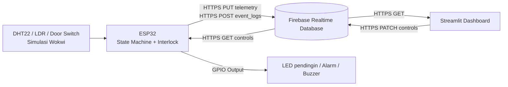

# 🧊 Smart Storage Room — IoT Kelompok 3

> **ESP32 + Wokwi + Firebase Realtime Database + Streamlit**  
> UTS Internet of Things · 5A MKB · Kelompok 3

Aplikasi monitoring dan pengendalian ruang penyimpanan **dalam simulasi** dengan sensor DHT22 (suhu dan kelembapan), LDR (cahaya), sakelar pintu, LED representasi pendingin, LED alarm, dan buzzer. Dashboard menyediakan mode demo Python terpisah dari simulasi Wokwi yang terhubung Firebase, serta pilihan tema terang/gelap.

> ⚠️ **Status:** Paket integrasi dan tes unit/mock siap. Untuk membuktikan komunikasi Wokwi–Firebase–Streamlit yang sesungguhnya, kelompok wajib menjalankan pengujian langsung dan menyertakan screenshot/video; tidak ada klaim deployment otomatis.

## Arsitektur



| Firebase Path | Penulis | Pembaca | Fungsi |
|---|---|---|---|
| `/telemetry` | Wokwi (akun device) | Dashboard (akun operator) | Suhu, RH, cahaya, pintu, alarm, cooler actual, state, heartbeat `updated_at` |
| `/controls` | Dashboard (akun operator) | Wokwi (akun device) | `mode`, `manual_cooler_req`, `inject_sensor_fault` |
| `/event_logs` | Wokwi (akun device) | Dashboard (akun operator) | Perubahan state, alarm, penolakan perintah, kesalahan komunikasi |

Komunikasi memakai **Firebase ID token** dengan autentikasi Email/Password melalui REST API dan Security Rules berbasis UID. Tidak memakai database secret lama atau service-account private key. Wokwi menggunakan `setInsecure()` hanya untuk simulasi kelas, **bukan TLS produksi**.

## Fitur

- **Monitoring:** suhu, kelembapan, cahaya dan status pintu, status pendingin aktual, alarm, state machine.
- **Live & Demo:** Demo Lokal adalah simulasi Python **tanpa Firebase**; Simulasi Wokwi Live memakai Firebase RTDB dan akun operator.
- **Indikator perangkat:** heartbeat server `updated_at` (ONLINE jika ≤16 detik, STALE bila lebih lama, UNKNOWN untuk ekspor lama tanpa heartbeat).
- **Kontrol dua arah:** AUTO/MANUAL, perintah pendingin ON/OFF, dan injeksi sensor fault. Interlock divalidasi di ESP32, bukan dashboard.
- **Event log:** riwayat kejadian yang ditulis oleh firmware dengan server timestamp dan boot ID, ekspor CSV, grafik historis selama halaman terbuka.
- **Tema:** pilihan Terang/Gelap dan tata letak responsif.

## Perilaku kontrol (parameter simulasi)

| Kondisi | Aksi firmware |
|---|---|
| Suhu ≥8°C | Pendingin diminta ON (mode AUTO) |
| Suhu ≤5°C | Pendingin diminta OFF (hysteresis) |
| Suhu ≥12°C / ≤10°C | Alarm suhu ON / OFF |
| RH ≥60% / ≤55% | Alarm kelembapan ON / OFF |
| Pintu dibuka | Pendingin OFF **segera** |
| Pintu terbuka ≥10 detik | Alarm pintu dan hitung pelanggaran |
| Terang saat pintu tertutup | Alarm cahaya + pendingin OFF |
| Sensor fault atau cloud failure | Safe state: pendingin OFF |
| Perintah manual ON saat interlock | Ditolak & dicatat ke event log |

*Catatan:* LED biru hanyalah **representasi pendingin**. Wokwi tidak memodelkan pendinginan fisik akibat LED. Angka ambang adalah parameter eksperimen kelompok, bukan standar desain pendingin fisik.

## Struktur repository

```text
.
├── README.md
├── START_HERE_INSTALL_RUN_SECRETS.txt    # panduan sangat detail & secrets template
├── wokwi/
│   ├── sketch.ino
│   ├── diagram.json
│   ├── libraries.txt
│   └── secrets.h.example
├── firebase/
│   ├── rules.example.json
│   └── seed_controls.json
├── streamlit/
│   ├── app.py
│   ├── firebase_client.py
│   ├── dashboard_data.py
│   ├── demo.py
│   ├── requirements.txt
│   ├── assets/theme.css
│   ├── .streamlit/config.toml
│   ├── .streamlit/secrets.toml.example
│   └── tests/test_integration.py
└── docs/MATRIKS_UJI.md
```

## Jalankan cepat

**A. Firebase:** Buat dua akun Firebase Authentication Email/Password (akun **device** untuk Wokwi, **operator** untuk dashboard), terapkan `firebase/rules.example.json` dengan dua UID yang sesuai, dan buat `/controls` sesuai `firebase/seed_controls.json`. Jangan import ulang seluruh root jika event lama perlu dipertahankan.

**B. Wokwi:** Buka proyek ESP32, salin `wokwi/{sketch.ino,diagram.json,libraries.txt}` dan buat file `secrets.h` dari `secrets.h.example`; isi Firebase URL, Web API Key, email+password akun *device*. Simulasi harus berjalan agar data terbaru muncul.

**C. Streamlit lokal:**

```bash
cd streamlit
python -m venv .venv
# Windows: .venv\Scripts\activate
# macOS/Linux: source .venv/bin/activate
python -m pip install -r requirements.txt
# Salin .streamlit/secrets.toml.example -> .streamlit/secrets.toml dan isi URL + API key
python -m streamlit run app.py
```

Di sidebar: gunakan **Demo Lokal** untuk mencoba tanpa jaringan; pilih **Simulasi Wokwi Live** dan login dengan akun operator untuk mengamati Firebase sebenarnya.

**D. Streamlit Community Cloud:** Upload repository GitHub tanpa `secrets.h` / `secrets.toml`. Di https://share.streamlit.io/ pilih main file `streamlit/app.py`, lalu masukkan bagian `[firebase]` yang sama ke **Secrets** dashboard cloud. Login akun operator di aplikasi, bukan menaruh password di GitHub.

> **Tutorial rinci, termasuk template isi `secrets.h`, `secrets.toml`, aturan Firebase, dan troubleshooting:** baca [`START_HERE_INSTALL_RUN_SECRETS.txt`](START_HERE_INSTALL_RUN_SECRETS.txt).

## Pengujian

```bash
cd streamlit
python -m unittest discover -s tests -v
```

Tes Python mencakup schema, login mock, izin update controls, validasi heartbeat, data demo/interlock, dan validitas diagram, **bukan** kompilasi Arduino aktual atau koneksi Firebase nyata. Gunakan [`docs/MATRIKS_UJI.md`](docs/MATRIKS_UJI.md) untuk lima skenario wajib UTS dan skenario integrasi tambahan. Ambil screenshot hasil nyata.

## Kesalahan umum & keamanan

- `HTTP -1`: masalah DNS/TLS/request; cek URL Firebase lengkap, Wi-Fi Wokwi, koneksi.
- `HTTP 401/403`: Firebase Authentication/token/Security Rules.
- `CLOUD_DATA_INVALID`: `/controls.mode` kosong atau tipe field salah; isi `AUTO` serta dua Boolean.
- `STALE`: dashboard dapat membaca Firebase, tetapi ESP32 tidak mengirim heartbeat terbaru.
- File `secrets.h` dan `.streamlit/secrets.toml` **tidak boleh masuk GitHub**. Nilai database secret/token lama yang pernah dibagikan harus dicabut/rotasi.
- **Jangan ubah Security Rules menjadi publik** hanya untuk menampilkan data.

## Anggota

Naail Safwan Saleh · Daniela Ivanka Maydina Siringoringo · Subhan · Adrian · Iqbal · Nayla.

> Dokumen ini disiapkan untuk proyek pembelajaran IoT; isi laporan dan video UTS harus sesuai demonstrasi yang benar-benar dilakukan oleh kelompok.

## Referensi

- [Wokwi ESP32 WiFi](https://docs.wokwi.com/guides/esp32-wifi)
- [Wokwi Slide Switch](https://docs.wokwi.com/parts/wokwi-slide-switch)
- [Firebase RTDB REST & Authentication](https://firebase.google.com/docs/database/rest/auth)
- [Firebase server timestamp](https://firebase.google.com/docs/database/rest/save-data)
- [Streamlit fragments](https://docs.streamlit.io/develop/api-reference/execution-flow/st.fragment)
- [Streamlit Secrets](https://docs.streamlit.io/develop/concepts/connections/secrets-management)
